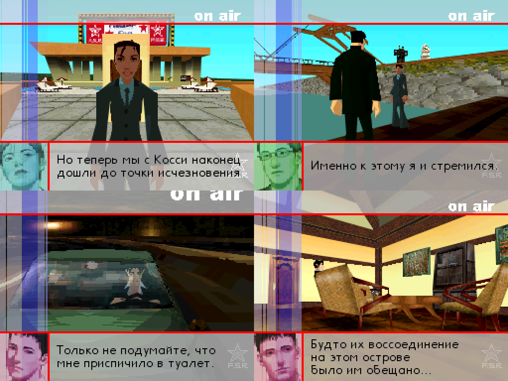
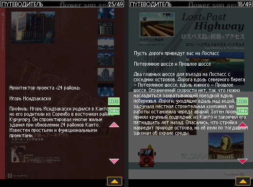

# Flower, Sun and Rain — русский перевод (альфа 0.1)

Любительский русификатор европейской версии **Flower, Sun and Rain: Murder and Mystery in Paradise** для Nintendo DS (код `YHNP`, En/Fr/De/Es/It). Перевод сделан с английского текста. Патч не содержит материалов игры: он применяется к вашей собственной копии рома.




## Что переведено
- Диалоги всех глав (C00–C18), сообщения Кэтрин и Эдо, экран сохранений, профили.
- Надписи интерфейса на спрайтах и фонах (меню, титул, ДА/НЕТ и т. п.).
- Путеводитель (Guide, 48 страниц из 49, 49-я пуста в оригинале) и Список находок (LostList, 19 карточек): тексты на картинках перерисованы русским шрифтом, подписи в рамках (здоровье, ISO, расписание вывоза мусора, составы) тоже.
- Русский шрифт добавлен в 4 шрифта игры.

## Чего нет (альфа)
- Очень мелкий текст на схемах и картинках (фамилии в составах, подписи фонов Списка находок), логотипы.
- Проверка в игре выборочная: начало каждой главы, Guide, LostList. Возможны неточности, неудачные переносы и мелкие графические огрехи. Сообщайте в [Issues](../../issues) — укажите главу, сцену и скриншот.
- Символы «№», «～», «！» в игровых шрифтах отсутствуют (заменены).

## Как поставить
Нужны оригинальный европейский ром (`.nds`, SHA-1 `4922df257dd3289114895ad734808917e60b2541`) и программа для патчей xdelta3 (xdelta UI, Delta Patcher, Rom Patcher JS или консольный `xdelta3`).

1. Скачайте `fsar-ru.xdelta` со страницы [Releases](../../releases).
2. Примените патч:
   ```
   xdelta3 -d -s "оригинал.nds" fsar-ru.xdelta "Flower Sun and Rain (RU).nds"
   ```
3. Проверьте SHA-1 результата по `CHECKSUMS.txt` из релиза.
4. Запускайте на melonDS 1.1 или на железе (3DS — через TWiLight Menu++ / nds-bootstrap; проверено на реальной 3DS: заставки, диалоги, Список находок). Игра создаст файл сохранения сама, чужие сохранения не нужны.

## Как собрать из исходников
Нужен свой ром в `roms/`. Всё делается Python-скриптами (`tools/venv`, ndspy, Pillow, openpyxl), ром собирается `scripts/build_rom.py`. Порядок и подводные камни — в `AGENTS.md` и `docs/`:
- `scripts/` — распаковка и сборка скриптов `.s`, вставка текста (`insert.py`, `check_table.py`), шрифты (`make_ru_font.py`), графика (`ds_gfx.py`, `gfx_*.py`: Guide, LostList, подписи в рамках `gfx_boxes.py`), LZ10-сжатие (`lz10.py`, `lz10c.c`).
- `macros/`, `scripts/tas.py` — воспроизводимые прохождения сцен в безголовом эмуляторе (`tools/melonds-ctl`), `scripts/check_walk.py` — пиксельная проверка окон реплик. Алгоритм проверки — `docs/verify-in-game.md`.
- `text/ru.csv`, `text/ru/` — перевод реплик, `text/gfx/` — тексты страниц-картинок, `text/STYLE.md` — правила перевода (ты/вы, термины, говорящие).

В `text/gfx/*.tsv` английская колонка скрыта (маска), оригинальный текст игры в репозиторий не входит.

## Как сделано
Перевод, инструменты и проверка в игре сделаны автором вместе с ИИ-ассистентом Claude (Anthropic, модель Claude Sonnet 5.5, `claude-sonnet-5-5`) через Claude Code: ассистент писал черновики перевода, скрипты и документацию, автор принимал решения, играл и проверял результат в эмуляторе.

## Лицензии
Код — MIT, драйвер эмулятора — GPL-3.0, перевод — CC BY-NC-SA 4.0. Подробности в [LICENSES.md](LICENSES.md).

Оригинальная игра © Marvelous Entertainment / Grasshopper Manufacture, издание в Европе — Rising Star Games. Проект неофициальный и некоммерческий.
